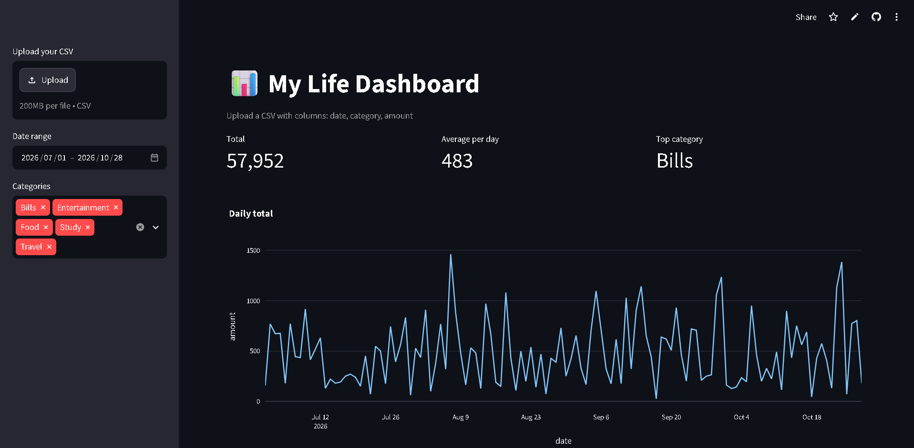

# Where Did My Salary Go?
### A free dashboard that turns any spreadsheet into clear charts

**Live demo:** [my-life-dashboardd.streamlit.app](https://my-life-dashboardd.streamlit.app)

---

## Preview

> Upload a CSV → filter by date and category → instantly see where the money went.

---

## The problem

Salary comes in on the 1st. By the 20th, the balance looks thin — and there is no clear answer to:

**Where did it all go?**

Excel can answer this, but only after filters, pivot tables, charts, and fixing typos like `Food` vs `food `. Every month. Again.

---

## The solution

A small Python web app that:

1. Accepts any CSV with 3 columns: `date`, `category`, `amount`
2. Cleans column names automatically
3. Shows summary cards + charts
4. Updates instantly when you change filters or upload a new file

No formulas. No pivot tables. No rebuild every month.

---

## Features

| Feature | What you get |
| --- | --- |
| Summary cards | Total, average per day, top category |
| Daily chart | See exact spending spikes |
| Category chart | Where the money actually goes |
| Monthly chart | Trend over time |
| Filters | Date range + multi-select categories |
| Safe errors | Clear messages instead of crashes |
| Sample data | Works out of the box |

---

## Quick start

### 1) Install

    pip install -r requirements.txt

### 2) Run

    streamlit run app.py

Or:

    python -m streamlit run app.py

Open the local link (usually http://localhost:8501).

---

## CSV format

Your file needs only these columns:

| Column | Example | Notes |
| --- | --- | --- |
| date | 2026-07-15 | Any normal date format |
| category | Food | Text label |
| amount | 250.50 | Number |

The app cleans spaces and capital letters in headers automatically.

---

## Project structure

    My-Life-Dashboard/
    ├── app.py
    ├── expenses.csv
    ├── requirements.txt
    ├── images/
    │   ├── dashboard.png
    │   └── demo.gif
    └── README.md

---

## Deploy on Streamlit Cloud

1. Push this repo to GitHub
2. Open https://share.streamlit.io
3. Create a new app
4. Select this repository
5. Main file path: app.py
6. Deploy

---

## Privacy

- The live demo uses sample data only
- Do not upload real bank statements to a public app
- For real financial data, run locally on your computer
- Never commit real personal finance files to a public repository

---

## Not only for money

Same 3-column format works for:

- Study hours per subject
- Freelance income per client
- Shop sales per product
- Content views per topic
- Job applications per platform
- Workout minutes per exercise

If it fits in a spreadsheet, it can become a dashboard.

---

## Tech stack

- **Python**
- **Streamlit** — interactive UI
- **Pandas** — cleaning + aggregation
- **Plotly** — charts

---

## Author

**Prabhakar Sharma**

AI engineer building agentic workflows and securing AI systems.

If this helped you:

- Try the [live demo](https://my-life-dashboardd.streamlit.app)
- Star this repo
- Share it with someone who still rebuilds the same Excel chart every month
